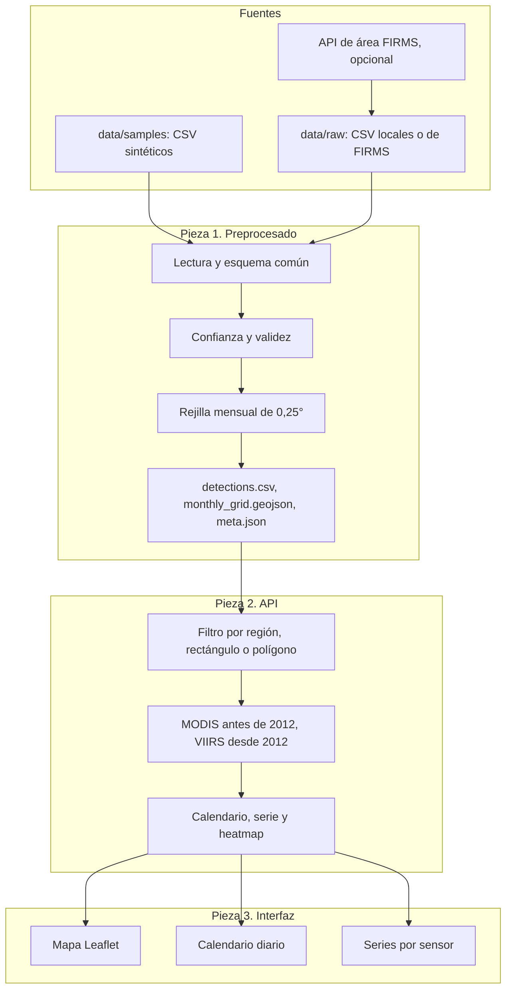
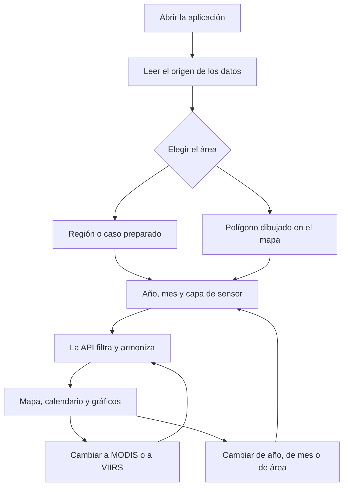
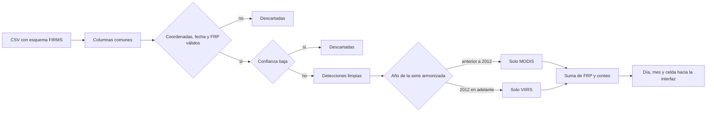

# Brasa

Calendario de actividad de quema para un área de interés. Junta detecciones de focos activos MODIS y VIIRS, las agrega por mes en una rejilla de 0,25° y muestra la serie de cada sensor junto a una serie armonizada. Es el MVP descrito para el reto de NASA Space Apps [Harmonization of MODIS and VIIRS Hot Spots](https://www.spaceappschallenge.org/2026/challenges/harmonization-of-modis-and-viirs-hot-spots/): un primer boceto para iterar, no un producto calibrado.

La serie armonizada usa MODIS antes de 2012 y VIIRS desde 2012. No hay factor de conversión radiométrico ni deduplicación de un mismo fuego visto por varios satélites.

**Los CSV que vienen en el repositorio son sintéticos.** Tienen el esquema de NASA FIRMS para que el calendario funcione sin clave y sin red, pero no son observaciones. El aviso permanece en la interfaz hasta que sustituyas `data/raw` por archivos reales y reconstruyas.

## Cómo ejecutarlo

Hace falta Python 3.12. Las dependencias están fijadas en `requirements.txt`.

```bash
python3 -m venv .venv
source .venv/bin/activate
pip install -r requirements.txt
pytest
python -m brasa
```

Abre http://localhost:8000. El atajo `scripts/run.sh` hace el venv, instala si falta algo y arranca el servidor.

No hace falta `FIRMS_MAP_KEY`. Si la variable no existe, o vale `DEMO_KEY` y FIRMS la rechaza, la aplicación sigue con la muestra. Una clave real se pide en [FIRMS Area API](https://firms.modaps.eosdis.nasa.gov/api/area/) y solo sirve para la descarga opcional:

```bash
export FIRMS_MAP_KEY=tu_clave
python scripts/fetch_firms.py --days 1
python -m brasa.pipeline.build
```

Esa descarga es de unos pocos días en tiempo casi real. Sustituye la muestra en el siguiente build. Para volver al calendario 2000-2026, borra `data/raw/*.csv` y `data/raw/ORIGIN` y reconstruye.

Para regenerar la muestra sintética (semilla fija `20261014`):

```bash
python scripts/generate_sample_data.py
python -m brasa.pipeline.build
```

Variables opcionales: `BRASA_HOST` (por defecto `0.0.0.0`), `BRASA_PORT` (por defecto `8000`), `BRASA_DATA_DIR`. Hay un ejemplo en `.env.example`. El proceso lee `.env` sin pisar lo que ya esté en el entorno.

## Qué se puede hacer en la interfaz

- Elegir España peninsular, California o Australia, o dibujar un polígono.
- Abrir un caso preparado: verano 2022 en España, otoño 2020 en California, enero 2020 en Australia.
- Cambiar año, mes y capa: armonizada, solo MODIS o solo VIIRS.
- Ver el mes en el mapa (celdas de 0,25°), el año en un calendario diario tipo GitHub y las dos series en los gráficos.
- Pasar de FRP acumulado a conteo de detecciones. El conteo deja ver el salto instrumental; el FRP es la métrica de trabajo.
- Los meses críticos se marcan cuando superan la climatología de ese mismo mes.

## Diagramas

### Arquitectura



### Flujo de uso



### Pipeline de datos



El detalle de cada caja está en [docs/pipeline-datos.md](docs/pipeline-datos.md), [docs/armonizacion.md](docs/armonizacion.md) y [docs/datos-y-limitaciones.md](docs/datos-y-limitaciones.md).

## Piezas

| Pieza | Dónde | Para qué |
| --- | --- | --- |
| Preprocesado | `brasa/pipeline/`, `scripts/` | Leer CSV, filtrar, agregar y exportar ficheros estáticos |
| API | `brasa/api/`, `brasa/services/` | Filtrar un área y devolver calendario, serie y celdas |
| Interfaz | `frontend/` | Mapa, calendario y gráficos. Leaflet 1.9.4 va en `frontend/vendor/` |

No hay base de datos. Al arrancar, si los ficheros de `data/processed/` no cuadran con los CSV de entrada, se reconstruyen.

La muestra actual, tras el filtro de confianza, conserva 9238 detecciones (5248 MODIS y 3990 VIIRS) entre el 2000-01-07 y el 2026-09-23. Se descartaron 2158 por confianza baja.

## Documentación

- [Arquitectura](docs/arquitectura.md)
- [Flujo de usuario](docs/flujo-usuario.md)
- [Pipeline de datos](docs/pipeline-datos.md)
- [Preprocesado](docs/preprocesado.md)
- [Armonización](docs/armonizacion.md)
- [API](docs/api.md)
- [Interfaz](docs/frontend.md)
- [Datos, supuestos y límites](docs/datos-y-limitaciones.md)
- [Decisiones a revisar](docs/decisiones.md)

## Pruebas

`pytest` cubre el filtro de confianza con cabeceras reales de FIRMS, la rejilla (incluido el hemisferio sur), la regla de 2012, el polígono, los meses críticos, la API y los tres casos preparados de la muestra.
