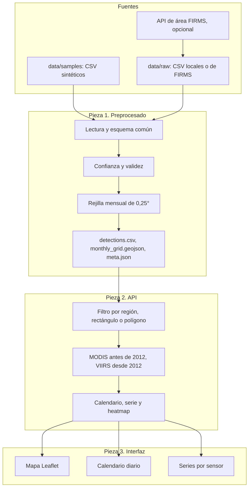

# Arquitectura

Brasa separa el trabajo en las tres piezas del MVP: un preprocesado offline, una API pequeña y una página estática. No comparten una base de datos. El contrato entre la pieza 1 y la pieza 2 son ficheros en `data/processed/`. El contrato entre la pieza 2 y la pieza 3 es JSON.

## Por qué esta forma

El reto pide explorar un área elegida por quien usa la herramienta. Un único GeoJSON global no basta: un polígono dibujado no coincide con las celdas precalculadas. Por eso el preprocesado deja dos productos:

- `monthly_grid.geojson` y `monthly_grid.csv` son la agregación de referencia, la que se puede inspeccionar sin levantar el servidor.
- `detections.csv` guarda cada foco ya limpio. La API lo carga en memoria y vuelve a sumar solo lo que cae dentro del área.

Con unas diez mil filas la segunda pasada es inmediata. Si más adelante entra un archivo continental de verdad, este diseño se queda corto y habría que consultar la rejilla ya agregada, o trocear por región. Está anotado en [decisiones](decisiones.md).

## Módulos

| Módulo | Responsabilidad |
| --- | --- |
| `brasa/config.py` | Rutas, año de corte 2012, tamaño de celda, umbral de confianza, texto de supuestos |
| `brasa/regions.py` | Tres áreas preparadas y tres casos de uso |
| `brasa/pipeline/ingest.py` | Descubre CSV y traduce columnas MODIS o VIIRS a un esquema |
| `brasa/pipeline/clean.py` | Descarta filas inválidas y de confianza baja, y cuenta las bajas |
| `brasa/pipeline/grid.py` | Asigna la celda de 0,25° y escribe CSV y GeoJSON |
| `brasa/pipeline/harmonize.py` | Regla de sensor de la serie armonizada |
| `brasa/pipeline/build.py` | Orquesta la exportación y decide si hay que rehacerla |
| `brasa/pipeline/fetch.py` | Descarga opcional de la API de área de FIRMS |
| `brasa/services/store.py` | Tabla en memoria |
| `brasa/services/query.py` | Área, calendario, serie anual, meses críticos y heatmap |
| `brasa/api/routes.py` | HTTP |
| `brasa/main.py` | FastAPI, ficheros estáticos y arranque |
| `frontend/js/app.js` | Estado de la página y llamadas |
| `frontend/js/map.js` | Mapa, dibujo y celdas |
| `frontend/js/calendar.js` | Rejilla de días |
| `frontend/js/charts.js` | Gráficos SVG |
| `frontend/js/api.js` | `fetch` de `/api/meta` y `/api/query` |

## Arranque

`python -m brasa` sirve la API en `/api` y la página en `/`. OpenAPI queda en `/docs`.

Al importar la aplicación se llama a `load_processed()`. Si `meta.json` no existe, si el hash de los CSV cambió o si `pipeline_version` no coincide, se vuelve a construir. Así un clone con los CSV de muestra arranca aunque alguien borre `data/processed/`.

## Qué no entra en esta arquitectura

No hay cola, ni caché, ni usuarios, ni teselas propias. El mapa base es CARTO oscuro sobre datos de OpenStreetMap y necesita red solo para las teselas. Los datos del calendario viajan desde el propio servidor.
