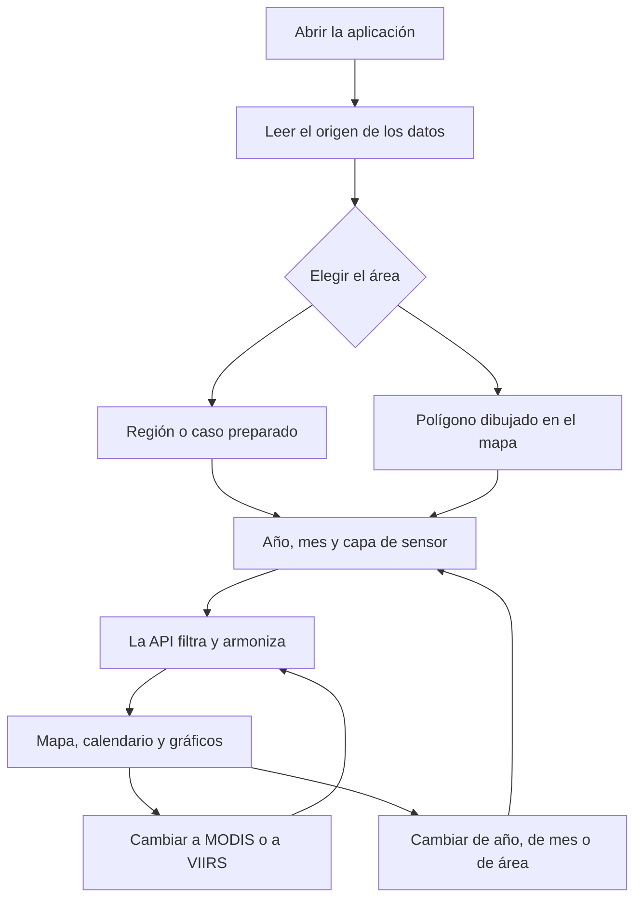

# Flujo de usuario

La página abre ya colocada en el caso de verano de 2022 en España, con la capa armonizada y el mes de julio. El banner superior dice de dónde salen los datos. Con la muestra de fábrica, dice que son sintéticos.

## Regiones y casos

Los tres botones de región ajustan el mapa a un rectángulo fijo:

| Id | Área | Caja oeste, sur, este, norte |
| --- | --- | --- |
| `spain` | España peninsular, sin Canarias | -9,5; 35,9; 3,4; 43,9 |
| `california` | California | -124,5; 32,5; -114,1; 42,1 |
| `australia` | Australia continental en sentido amplio | 112; -44; 154; -10 |

Los casos preparados solo fijan región, año, mes y capa. No cambian el cálculo.

| Caso | Dónde mira |
| --- | --- |
| Verano 2022 en España | Julio 2022, serie armonizada |
| Otoño 2020 en California | Septiembre 2020 |
| Enero 2020 en Australia | Enero 2020, verano austral en el sureste de la muestra |

En la muestra, Australia mezcla dos calendarios a propósito: el sureste quema en diciembre-febrero y el norte en la estación seca. Un polígono sobre Victoria y otro sobre el Territorio del Norte no cuentan la misma estación. Con datos reales pasaría lo mismo; aquí el generador lo fuerza para que se pueda enseñar.

## Dibujar un área

1. Pulsar **Dibujar área**.
2. Hacer clic en el mapa. Cada clic añade un vértice.
3. Con tres o más, **Cerrar polígono** (o Intro). Escape o **Cancelar** lo deshacen.
4. La consulta pasa a ser el polígono. La región deja de aplicarse hasta que se elige otra vez un botón de región o un caso.

El servidor recibe vértices `[longitud, latitud]`, que es el orden GeoJSON, no el de Leaflet.

## Qué cambia cada control

| Control | Efecto |
| --- | --- |
| Armonizada / MODIS / VIIRS | Cambia el calendario, el mapa, los meses críticos y el total de la capa. Los gráficos de barras siguen mostrando los dos sensores. |
| FRP / Conteo | No vuelve a pedir datos. Recolorea con la suma de FRP o con el número de detecciones que ya vinieron en la respuesta. |
| Año | Mueve calendario, serie resaltada y climatología del año. |
| Mes, en las pastillas o en el gráfico | Cambia el heatmap. No cambia el calendario, que es el año entero. |
| Clic en un día | Muestra fecha, FRP y conteo de ese día. No filtra el mapa. |
| Clic en un año del gráfico largo | Cambia el año. |

El recuadro discontinuo del mapa es el área activa. El color de las celdas es la métrica del mes, en una escala logarítmica dentro de ese mes, no una escala fija mundial.

## Lectura de un mes crítico

Un punto rosa en el gráfico del año, el borde de la pastilla del mes y el borde de los días de ese mes quieren decir lo mismo: ese mes, en la capa activa, supera la media histórica de ese mes más 1,5 desviaciones típicas y además concentra al menos un 25 % del pico anual. La regla está explicada en [armonización](armonizacion.md). No es una alerta operativa.

## Vacío

Si la capa no tiene focos en ese mes, el mapa lo dice. VIIRS antes de 2012 sale vacío en esta muestra porque el generador no inventa un sensor que aún no existía. MODIS en 2022 sigue teniendo celdas: es la capa comparativa del solape.
