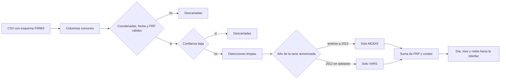

# Pipeline de datos

Esta página recorre el camino completo: de dónde salen las filas, cómo se limpian, dónde se guardan, qué se calcula y cómo llega a la pantalla. Los límites están reunidos otra vez en [datos y limitaciones](datos-y-limitaciones.md).

## Fuentes

Hay tres orígenes. Solo uno manda en cada build.

1. **Muestra sintética** en `data/samples/modis_demo.csv` y `data/samples/viirs_demo.csv`. Es el camino por defecto. El generador (`scripts/generate_sample_data.py`, semilla `20261014`) imita el esquema público de FIRMS y reparte focos en España, California y Australia entre 2000 y septiembre de 2026. No reproduce incendios reales. Los picos de julio 2022, septiembre 2020 y enero 2020 están metidos a mano para que los casos de uso tengan un mes extremo que enseñar.
2. **CSV locales** en `data/raw/*.csv`. Si hay cualquiera, el build ignora la muestra. Sirve para un archivo FIRMS descargado antes del hackathon, que es lo que pedía la propuesta.
3. **API de área de FIRMS**, opcional, con `FIRMS_MAP_KEY`. `scripts/fetch_firms.py` pide hasta 5 días de producto NRT para las tres cajas y guarda `data/raw/firms_*.csv` más un marcador `ORIGIN` con el texto `firms_api`. Sin clave no llama a la red. Con el valor `DEMO_KEY`, prueba una vez y, si FIRMS lo rechaza, termina bien y deja la muestra como está. FIRMS no usa la `DEMO_KEY` de Earthdata; la clave es un `MAP_KEY` propio.

La URL de área es:

`https://firms.modaps.eosdis.nasa.gov/api/area/csv/{MAP_KEY}/{SOURCE}/{oeste},{sur},{este},{norte}/{días}`

Fuentes pedidas: `MODIS_NRT`, `VIIRS_SNPP_NRT`, `VIIRS_NOAA20_NRT`, `VIIRS_NOAA21_NRT`. Una respuesta que no empiece por `latitude,` se descarta.

Mezclar muestra y CSV reales (`python -m brasa.pipeline.build --include-samples`) existe para pruebas y marca el origen como `mixed`. Los conteos de esa mezcla no se interpretan.

## Esquema que acepta el lector

El sensor se deduce de las columnas, no del nombre del fichero. Si aparece `bright_ti4` o `bright_ti5`, la fila es VIIRS 375 m. Si no, se trata como MODIS.

Cabecera MODIS, tal como la publica FIRMS en el CSV de 24 h:

`latitude,longitude,brightness,scan,track,acq_date,acq_time,satellite,confidence,version,bright_t31,frp,daynight`

Cabecera VIIRS 375 m:

`latitude,longitude,bright_ti4,scan,track,acq_date,acq_time,satellite,confidence,version,bright_ti5,frp,daynight`

También se aceptan alias `lat` / `lon` / `date`. La hora `acq_time` es HHMM: `0037` son las 00:37 y `1359` las 13:59. No se recalcula el flag día/noche; se conserva el de la fila.

Columnas internas después de la lectura: `lat`, `lon`, `acq_date`, `hour`, `satellite`, `sensor` (`modis` o `viirs`), `confidence`, `confidence_class`, `frp`, `daynight`, `brightness`, `version`, `source_file`.

`brightness` guarda la temperatura de brillo del canal de fuego (`brightness` en MODIS, `bright_ti4` en VIIRS). No se usa en la métrica. El canal de fondo (`bright_t31`, `bright_ti5`) no entra en el cálculo: no es el mismo producto físico en los dos sensores.

## Limpieza

Una fila se tira si:

- la latitud no está en [-90, 90] o la longitud no está en [-180, 180];
- la fecha no se entiende;
- el FRP falta o es negativo;
- la confianza falta o no se reconoce;
- la confianza es baja.

Confianza baja:

- MODIS numérico, por debajo de 30. En la documentación de FIRMS, 0-29 es low, 30-79 nominal y 80-100 high. El 30 se conserva.
- VIIRS en texto: `low` o `l`. Se conservan `nominal`, `n`, `high` y `h`.
- Si un VIIRS futuro viniera en número 0-100, se usan los mismos cortes que MODIS.

En la muestra de fábrica entran 11396 filas y se quedan 9238. Las 2158 bajas son el filtro funcionando, no un fallo.

No se corrige FRP por ángulo de observación (`scan` / `track`), ni por hora local, ni por el tamaño del píxel.

## Agregación y almacenamiento

No hay base de datos. `python -m brasa.pipeline.build` escribe en `data/processed/`:

| Fichero | Qué es |
| --- | --- |
| `detections.csv` | Focos limpios, una fila por detección. Es lo que carga la API. |
| `monthly_grid.csv` | Una fila por sensor, año, mes y celda, con `count`, `frp_sum` e `in_harmonized_series`. |
| `monthly_grid.geojson` | Las mismas celdas como polígonos. Es el fichero estático que pedía el MVP para no depender de una base de datos. |
| `meta.json` | Origen, rango de fechas, recuentos, supuestos y la firma SHA-256 de los CSV de entrada. |

La celda es el borde suroeste del cuadrado de 0,25° que contiene el punto. La latitud -33,0001 cae en la celda que empieza en -33,25. Un borde exacto, 40,25, se queda en la celda que empieza en 40,25.

`in_harmonized_series` es verdadero si la celda es MODIS anterior a 2012 o VIIRS de 2012 en adelante. El GeoJSON no mezcla los dos sensores en una sola geometría: cada sensor sigue en su feature para poder comparar.

La firma de los CSV evita reconstruir en cada arranque. Si cambia el código de supuestos, `PIPELINE_VERSION` en `brasa/config.py` obliga a reescribir `meta.json`.

## Procesado en la consulta

La API no relee el GeoJSON para responder. Carga `detections.csv` en un `DataFrame` y, para cada consulta:

1. Recorta por la caja de la región, por un bbox, o por un polígono (ray casting, vértices en orden `[lon, lat]`).
2. Separa MODIS, VIIRS y la serie armonizada con la regla de 2012.
3. Suma FRP y cuenta filas por día del año elegido (calendario), por mes (gráfico y meses críticos) y por celda del mes elegido (heatmap).
4. Compara cada mes del año con la climatología descrita en [armonización](armonizacion.md).

La suma de FRP está en megavatios de detección, no en energía. No integramos en el tiempo para obtener Fire Radiative Energy, porque una fila no trae la duración del fuego. Varias filas del mismo incendio (Terra y Aqua, o tres VIIRS) se suman. Eso infla el total y es una decisión consciente del MVP: no hay clustering.

## Cómo llega a la interfaz

`GET /api/query` o `POST /api/query` devuelven un JSON con el área, el resumen del año y del mes, el calendario diario, los doce meses, la serie anual, las plataformas que observaron ese año y un `FeatureCollection` del mes. El navegador no recalcula la climatología. Solo elige, en local, si pinta `frp` o `count`, y reparte los días con FRP en cuatro cuantiles para el color del calendario.

El mapa pide teselas a CARTO. Si no hay red, el calendario y las cifras siguen; el fondo del mapa no.
